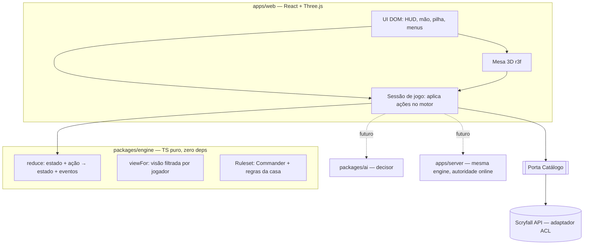

# Design — 00 · Visão geral do The Gathering Hall

## Skills aplicadas
| Skill | Por que foi escolhida | Princípios aplicados aqui |
|-------|----------------------|---------------------------|
| clean-architecture | Separar regras de jogo de UI, rede e fontes de dados | Dependency Rule; o motor é o centro; Scryfall, Three.js e React são detalhes |
| domain-driven-design | O domínio (regras de Magic) é rico e é o core subdomain | Bounded contexts, linguagem ubíqua, eventos de domínio, ACL para Scryfall |
| software-architecture-basics | Escolher o estilo e limitar as -ilities | Modular monolith particionado por domínio; ADRs |
| evolutionary-architecture | Magic muda todo ano; o projeto também | Fitness functions no CI, Last Responsible Moment, anticorruption layers |
| ux-design | O diferencial é a interface | Feedback imediato, carga cognitiva baixa, Fogg B=MAP para ações rápidas |
| secure-coding | Input de usuário (decklists) e, no futuro, rede | Never trust input, visão filtrada por jogador, sem segredos no cliente |

## Visão geral da arquitetura
Estilo: **modular monolith particionado por domínio**, num monorepo com npm workspaces. Começa 100% no cliente.
O servidor vem depois e reaproveita o mesmo motor.



### Bounded contexts (épicos)
| Contexto | Épico | Tipo de subdomain | Padrão de lógica |
|---|---|---|---|
| Motor de regras | 02 | **Core** | Domain model puro, event log |
| Mesa interativa | 03 | **Core** (diferencial de produto) | UI sobre o motor |
| Regras e formatos | 04 | Supporting | Dados versionados + validadores |
| Catálogo de cartas | 01 | Generic/Supporting (fonte Scryfall) | ACL + cache versionado |
| Decks | 05 | Supporting | Transaction script |
| Oponente IA | 06 | Core (fase posterior) | Decisor plugável |

## Estrutura do repositório (screaming architecture)
```
.specs/                  ← specs vivas por épico
packages/engine/         ← @gathering-hall/engine (motor; não importa nada de fora)
apps/web/                ← @gathering-hall/web (Vite + React + r3f)
spikes/                  ← protótipos descartáveis (fora do build)
LICENSE · LEGAL.md · README.md
```
Pacotes futuros: `packages/catalog`, `packages/cards` (scripts de carta), `packages/ai`, `apps/server`.

## Linguagem ubíqua (glossário)
Os termos são em português no código de domínio quando houver tradução oficial. Caso contrário, ficam em inglês.
Nos identificadores de código, usamos **inglês**, igual às Comprehensive Rules.
| Termo | Código | Significado |
|---|---|---|
| Objeto de jogo | `GameObject` | Instância de uma carta ou token numa partida (o mesmo Oracle pode ter várias) |
| Zona | `ZoneKind` | library, hand, battlefield, graveyard, exile, stack, command |
| Ação | `Action` | Intenção de um jogador (comando). Pode ser recusada |
| Evento | `GameEvent` | Algo que aconteceu (passado). Produzido pelo motor |
| Decisão pendente | `PendingDecision` | O que o motor espera, e de quem |
| Ruleset | `Ruleset` | Conjunto de regras ativas: Commander oficial + regras da casa |
| Cobertura | `Coverage` | automated / partial / manual — o quanto o motor entende a carta |
| Visão do jogador | `PlayerView` | Estado filtrado pelo que aquele jogador pode ver |

## Decisões (ADRs resumidos)
- **ADR-001 — Motor próprio em TypeScript em vez de embutir XMage/Forge.**
  - *Contexto:* XMage tem licença MIT e é cliente-servidor. Forge tem regras mais fiéis, mas é GPL. Os dois são
    JVM, síncronos (uma thread por partida) e sem versionamento.
  - *Decisão:* escrevemos nosso motor e usamos os dois como referência.
  - *Trade-off:* anos até a cobertura deles, em troca de controle total, web nativa e estado serializável.
    O fallback manual por carta reduz a dor.
- **ADR-002 — Motor como função pura sobre estado imutável e serializável.**
  - *Por quê:* undo, replay, reconexão, simulação para IA e testes determinísticos saem quase de graça.
  - *Trade-off:* mais alocação de memória do que mutação. Mitigado com estruturas pequenas e normalizadas
    (objetos por id).
- **ADR-003 — Decisões explícitas no estado (`pendingDecision`), não threads bloqueadas.**
  - *Por quê:* a fraqueza central de XMage e Forge (esperar input numa thread) some, e o estado pode ser salvo
    a qualquer momento.
- **ADR-004 — Mesa em Three.js (r3f) e o restante em DOM.**
  - *Por quê:* visual estilo Arena com câmera (foco no oponente) e efeitos; o DOM é imbatível para texto e menus.
  - *Evidência:* o spike `render-bench` deu 120 fps até 320 cartas no Mac. Falta medir em tablet.
- **ADR-005 — Cartas como dados com schema tipado (épico 02/cartas), nunca como classes.**
  - *Por quê:* Forge mostra que mais de 99% das cartas cabem em dados. O schema tipado evita a DSL de strings
    soltas dele.
- **ADR-006 — Scryfall atrás de uma porta de catálogo (ACL).**
  - *Por quê:* evita o anti-padrão "Vendor King". Trocar por MTGJSON ou por um backend próprio não afeta
    o motor nem a UI.
- **ADR-007 — Monorepo com npm workspaces, Vitest, oxlint e TypeScript estrito.**
  - *Por quê:* ferramenta única e simples para contribuidores; o Node 24 já traz o npm.
- **ADR-008 — Licença MIT + Fan Content Policy.**
  - Sem dados ou imagens da Wizards no repositório.
  - Aviso obrigatório.
  - Sem logos.
  - Sem proxies.

## Fitness functions (governança automatizada)
1. **Pureza do motor:** `packages/engine` não importa nenhum módulo de fora dele mesmo.
   É um teste que varre os imports.
2. **Sem nomes de carta no núcleo:** o código do motor não contém strings de nomes de carta.
   Isso evita as ~60 gambiarras do Forge.
3. **Sem vazamento de informação oculta:** `viewFor(state, p)` nunca contém a mão de outro jogador nem
   a ordem do grimório. É um teste property-based com estados aleatórios.
4. **Determinismo:** replay(estado inicial, ações) gera um estado idêntico ao original.
5. **Serializabilidade:** `JSON.parse(JSON.stringify(state))` é igual a `state` para todo estado gerado nos testes.

## Roadmap por fases
| Fase | Entrega | Épicos | Estado |
|---|---|---|---|
| **1 — Mesa sandbox** | Goldfish e hot-seat de 4 lugares, regras assistidas | 02, 03 | ✅ feito |
| **2a — Decks e regras** | Editor e biblioteca de decks, validação por preset, regras da casa que restringem, bracket | 04, 05 | ✅ feito |
| **2b — Online + catálogo** | Salas por link, servidor autoritativo, catálogo versionado (errata e banlist por data) | 07, 01 | ✅ feito |
| 3a — Regras de turno e tempo | Velocidade de feitiço, terreno por turno, mana cobrada, combate com dano calculado, paradas automáticas | 09 | ✅ feito |
| **3b+ — Editor de decks estilo Moxfield** | Visualizações (lista, pilhas, grade), categorias, "Talvez", estatísticas, modo texto, histórico, pastas, import por link (Archidekt e Moxfield) e link público | 10 | ✅ feito |
| **3b — Contas opcionais** | Login opcional (Discord e Google), decks e presets na nuvem, lugar nas salas, histórico, banco em Postgres | 08 | ✅ feito |
| 3c — Automação de cartas | Efeitos como dados, leitor do Oracle + exceções por carta, mana variável, mágicas e "entra no campo", habilidades ativadas, contagens, busca e vidência, alvos na mesa, cobertura medida pelo EDHREC (18,3% automáticas no top 1.000) | 11 | ✅ feito (falta conferir no tablet real) |
| 3d — Automação, onda 3 | Equipar e Auras, efeitos contínuos, gatilhos de morrer e atacar, modos, contramágicas, Ciclagem, terrenos com condição | — | a especificar |
| 4 — Bots | Bot heurístico → simulação → político | 06 | |

07 e 01 foram agrupados porque os dois precisam de backend. A infraestrutura (salas e banco) é montada uma vez só.

## Riscos e mitigações
- **Escopo infinito (regras de Magic)** → fallback manual por carta e automação incremental, priorizando as cartas
  mais jogadas em Commander.
- **Desempenho em tablet** → medir no spike com tablet real antes da fase 2. Plano B: LOD, texturas menores,
  sombras desligadas.
- **Política da Wizards** (mecânicas de jogo não cobertas explicitamente) → seguir a política à risca, não
  redistribuir dados, ter processo de takedown e, opcionalmente, pedir permissão.
- **Dependência do Scryfall** → ACL + cache local. Respeitar o rate limit e as diretrizes deles.
